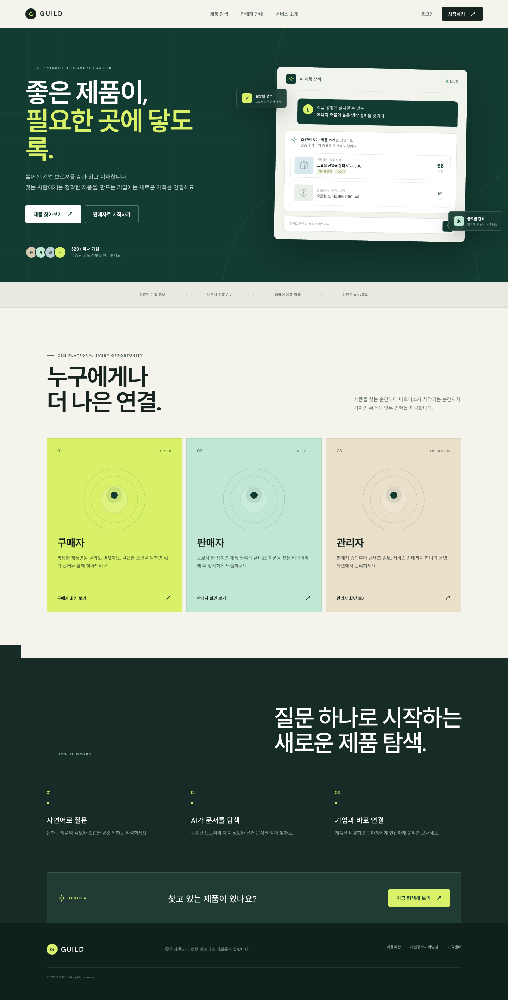
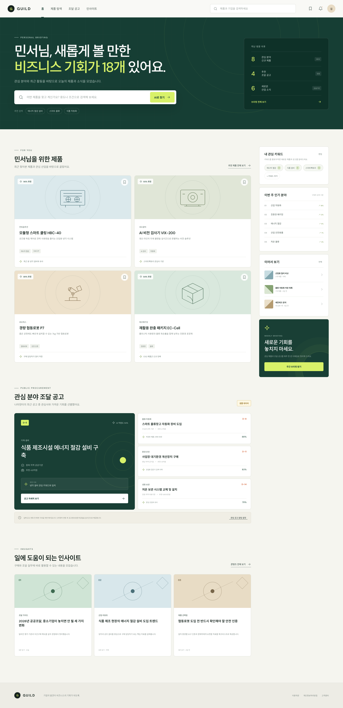
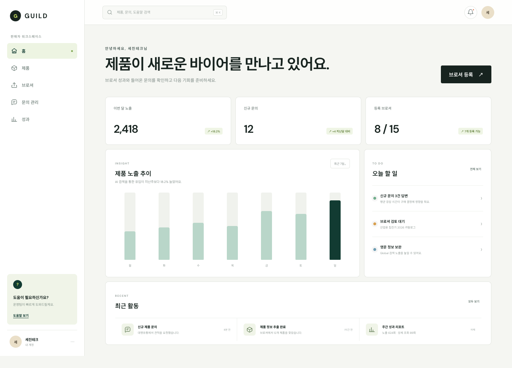
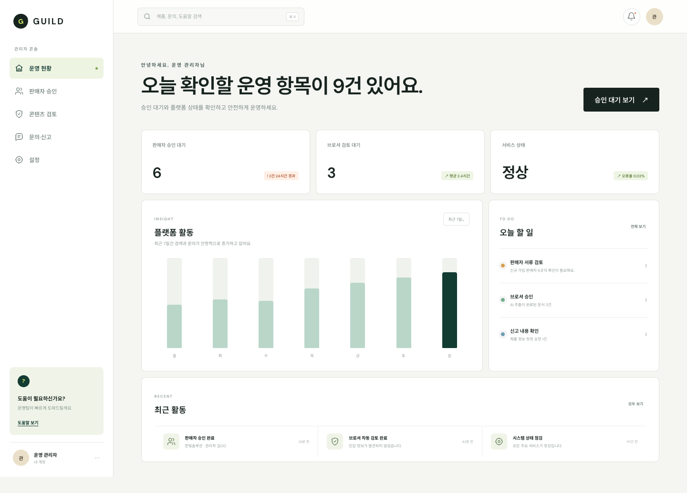
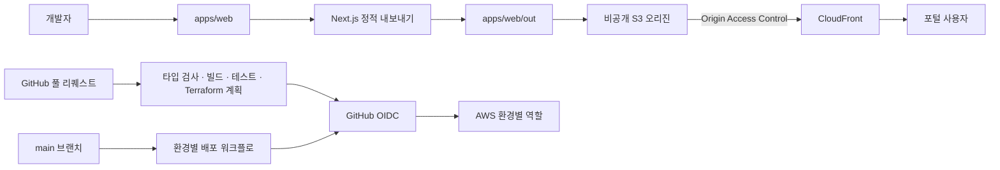

# GUILD

AI가 기업 브로슈어를 읽고 구매자에게는 적합한 제품을, 판매자에게는 새로운 B2B 기회를 연결하는 산업 제품 탐색 포털입니다.

현재 저장소에는 공개 랜딩 페이지, 개인화 구매자 포털, 판매자 워크스페이스, 관리자 콘솔과 정적 웹 배포 기반이 구현되어 있습니다. 화면의 상품·조달·성과 데이터는 UI 검증을 위한 예시이며 아직 실제 외부 시스템과 연결되지 않았습니다.

## 현재 구현 상태

| 영역 | 상태 | 설명 |
| --- | --- | --- |
| 랜딩 페이지 | 구현 및 정적 빌드 완료 | 서비스 소개, AI 탐색 예시, 역할별 진입 경로 |
| 구매자 포털 | UI 구현 완료 | 개인 브리핑, 상품 추천, 조달 공고, 인사이트, 관심 키워드 |
| 판매자 워크스페이스 | UI 구현 완료 | 노출·문의·브로슈어 지표, 할 일, 최근 활동 |
| 관리자 콘솔 | UI 구현 완료 | 판매자 승인, 브로슈어 검토, 서비스 상태, 운영 작업 |
| Next.js 정적 내보내기 | 구현 및 로컬 검증 완료 | `apps/web/out` 생성, 생성물은 Git에서 제외 |
| Terraform 기반 | 저장소 구현 완료, AWS 적용 대기 | `dev`·`staging`·`prod`, 비공개 S3, CloudFront OAC, KMS, 로그 |
| GitHub Actions 및 AWS OIDC | 저장소 구현 완료, 활성화 대기 | 풀 리퀘스트 계획, 개발 환경 자동 배포, 스테이징·운영 승인 게이트 |
| Cognito 비공개 개발 환경 게이트 | 설계 완료, 구현 대기 | 관리자 생성 사용자만 허용하고 자체 회원가입 차단 예정 |
| API·워커·실데이터 연동 | 구현 대기 | 검색/RAG, 브로슈어 처리, 결제, 문의, 조달 수집 및 매칭 |

> AWS 계정 복구와 대상 계정 확인이 완료되지 않아 현재 AWS 리소스는 배포하지 않았습니다.

## 구현 화면

모든 이미지는 현재 Next.js 운영용 정적 내보내기 결과를 1440px 너비로 캡처한 전체 페이지 화면입니다.

### 1. 공개 랜딩 페이지 — `/`

AI 기반 B2B 제품 탐색 흐름과 구매자·판매자·관리자별 진입점을 소개합니다.



### 2. 개인화 구매자 포털 — `/dashboard/buyer`

구매자 관심사와 최근 활동을 기준으로 상품 추천, 조달 기회, 산업 인사이트, 저장 활동을 한 화면에 구성합니다. 현재 조달 공고와 추천 값은 예시 데이터임을 화면에서 명시합니다.



### 3. 판매자 워크스페이스 — `/dashboard/seller`

상품 노출, 신규 문의, 브로슈어 사용량과 판매자가 처리해야 할 작업 및 최근 활동을 보여줍니다.



### 4. 관리자 콘솔 — `/dashboard/admin`

판매자 승인, 브로슈어 검토, 신고 확인, 서비스 상태 등 운영자가 확인해야 할 항목을 제공합니다.



## 기술 구성

- **웹:** Next.js 16.2.10, React 19.2.7, TypeScript 5.9.3
- **저장소:** npm workspaces 기반 모노레포
- **웹 배포 형식:** Next.js App Router 정적 내보내기
- **인프라:** Terraform, AWS S3, CloudFront, KMS, CloudWatch
- **배포 인증:** GitHub Actions OIDC와 단기 AWS STS 자격 증명
- **예정 서비스:** Cognito, Lambda@Edge, API Gateway, Lambda, Step Functions, Aurora Serverless v2, OpenSearch Serverless, Textract, Bedrock, SES

## 아키텍처

현재 저장소에 구현된 정적 웹 배포 경로는 다음과 같습니다. AWS 계정 활성화 전이므로 구성과 로컬 검증만 완료된 상태입니다.



목표 애플리케이션 경계는 다음과 같습니다.

```text
apps/web      구매자·판매자·관리자 웹 경험
apps/api      공개 및 인증 HTTP API(구현 예정)
apps/workers  브로슈어·결제·조달·알림 비동기 작업(구현 예정)
```

## 로컬 실행

### 사전 요구사항

- Node.js `>=20.9.0`
- npm

### 설치 및 개발 서버

```bash
npm ci
npm run dev:web
```

브라우저에서 [http://localhost:3000](http://localhost:3000)을 엽니다.

### 검증 및 정적 빌드

```bash
npm run typecheck:web
npm run build:web
node --test tests/repository-structure.test.mjs
```

빌드가 완료되면 정적 결과가 `apps/web/out`에 생성됩니다. 이 디렉터리는 배포 시 CI가 다시 생성하므로 Git에 커밋하지 않습니다.

## 저장소 구조

```text
.
├── .github/workflows/            Terraform 계획 및 환경별 배포 워크플로
├── .kiro/specs/ai-b2b-portal/    한국어 요구사항·설계·작업 명세
├── apps/
│   ├── web/                      Next.js 포털
│   ├── api/                      API 경계(구현 예정)
│   └── workers/                  비동기 워커 경계(구현 예정)
├── docs/
│   ├── runbooks/                 CI/CD 운영 절차
│   └── screenshots/              현재 구현 화면 캡처
├── infra/
│   ├── bootstrap/                원격 상태 및 GitHub OIDC 부트스트랩
│   ├── environments/             dev·staging·prod 환경 구성
│   └── modules/foundation/       공유 보안·네트워크·정적 호스팅 기반
└── tests/                         저장소 및 Terraform 구조 검사
```

## 배포와 보안 원칙

- GitHub Actions는 장기 AWS 액세스 키 대신 OIDC로 발급한 단기 자격 증명을 사용합니다.
- 환경별 역할과 상태 접근 권한을 분리하고 신뢰 정책을 저장소·브랜치·GitHub Environment 주체로 제한합니다.
- 정적 사이트 S3 버킷은 공개 접근을 차단하고 CloudFront OAC를 통한 접근만 허용하도록 정의합니다.
- `.env`, Terraform 상태/계획, 빌드 출력, 의존성 디렉터리는 Git에서 제외합니다.
- 스테이징과 운영 배포에는 GitHub Environment 승인 게이트를 사용합니다.
- 계획된 비공개 개발 환경은 Cognito 자체 회원가입을 비활성화하고 관리자가 승인한 사용자만 생성하도록 설계합니다.
- AWS 계정과 주체를 확인하고 Terraform 계획을 검토하기 전에는 클라우드 리소스를 적용하지 않습니다.

자세한 활성화 절차는 [`docs/runbooks/ci-cd.md`](./docs/runbooks/ci-cd.md)를 참고하세요.

## 명세

한국어 문서를 유일한 기준 명세로 사용합니다.

- [요구사항](./.kiro/specs/ai-b2b-portal/requirements.md)
- [설계](./.kiro/specs/ai-b2b-portal/design.md)
- [작업 계획](./.kiro/specs/ai-b2b-portal/tasks.md)

## 데이터 및 기능 고지

현재 화면은 제품 방향과 사용자 흐름을 검증하기 위한 구현입니다. 상품, 기업, 조달 공고, 매칭 점수, 문의, 성과 지표, 산업 인사이트는 예시 데이터이며 실제 거래·공고·운영 상태를 나타내지 않습니다. 인증, 검색/RAG, 브로슈어 처리, 결제, 문의, 조달 API 연동은 해당 작업이 구현되고 검증되기 전까지 동작한다고 간주하지 않습니다.
# jejoin
제조인 프로젝트
