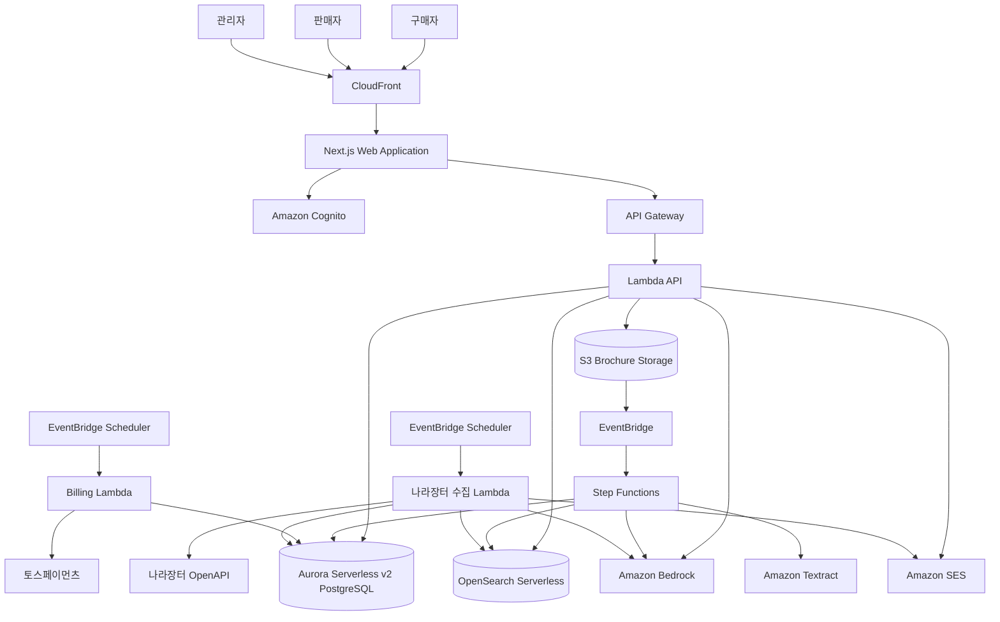
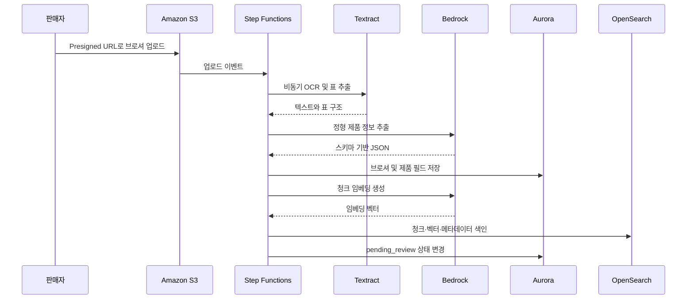

# AI 기반 B2B 브로셔 검색·중개 포털 구현 계획

## 1. Problem Statement

한국 중소기업이 제품 브로셔를 등록하면 AI가 문서의 텍스트, 표, 제품 사양을 추출하고 RAG 지식베이스를 구축한다. 국내외 구매자는 자연어와 대화형 검색으로 제품을 찾고 플랫폼을 통해 판매자에게 문의할 수 있다.

판매자에게 월 10만·15만·20만원의 누적형 멤버십을 제공하며, 브로셔 등록 한도, 영어·일본어 검색 노출, 나라장터 신규 공고 매칭 알림을 티어별로 차등 제공한다.

## 2. 확정 요구사항

### 2.1 사용자

- 판매자는 한국 중소기업으로 한정한다.
- 사업자 자동 인증은 MVP에서 제외하고 이메일 기반으로 가입한다.
- 관리자의 사전 승인 이후 브로셔를 게시할 수 있다.
- 구매자는 국내외 사용자 모두 허용한다.
- 비회원도 검색할 수 있지만 판매자 문의 시 회원가입이 필요하다.
- 관리자는 판매자·브로셔 승인, 구독 현황 및 신고 처리를 담당한다.

### 2.2 브로셔 처리

- PDF, JPG, PNG 등 PDF·이미지 브로셔를 지원한다.
- 한국어·영어·일본어를 포함한 다국어 브로셔를 처리한다.
- OCR로 일반 텍스트와 표 구조를 추출한다.
- 제품명, 모델명, 규격, 재질, 가격대, 인증정보 등 정형 필드를 저장한다.
- 원문은 청크로 분할하고 임베딩하여 RAG 검색에 사용한다.
- 처리 상태는 `uploaded → extracting → structuring → indexing → pending_review → published/failed`로 관리한다.

### 2.3 검색

- 일반 검색 결과 리스트와 대화형 RAG 검색을 모두 제공한다.
- 결과에는 제품, 판매자, 관련도 및 브로셔 근거 문장을 표시한다.
- 한국어 검색은 모든 멤버십 상품에 적용한다.
- 영어·일본어 검색에서는 15만원 이상 판매자의 제품만 노출한다.
- 승인되지 않았거나 구독이 정지된 판매자의 제품은 검색 결과에서 제외한다.

### 2.4 멤버십

| 티어 | 월 요금 | 브로셔 한도 | 다국어 검색 노출 | 나라장터 매칭 |
|---|---:|---:|---|---|
| Basic | 100,000원 | 10개 | 한국어 | 없음 |
| Global | 150,000원 | 15개 | 한국어·영어·일본어 | 없음 |
| Procurement | 200,000원 | 20개 | 한국어·영어·일본어 | 제공 |

- 상위 티어는 하위 티어의 기능을 모두 포함한다.
- 한도에 도달하면 추가 업로드를 차단하고 업그레이드를 안내한다.
- 티어 변경, 결제 실패, 해지 및 재결제 상태를 관리한다.
- 다운그레이드 후 한도를 초과한 기존 브로셔는 유지하되 신규 업로드를 차단한다.

### 2.5 결제

- 토스페이먼츠 자동결제 빌링 API를 사용한다.
- 카드 등록 후 빌링키를 발급받아 월 단위로 자동 결제한다.
- EventBridge Scheduler와 Lambda가 결제 일정을 실행한다.
- 결제 성공·실패·재시도·해지 이력을 저장한다.
- 토스페이먼츠 시크릿과 빌링키는 암호화하여 관리한다.

### 2.6 문의 중계

1. 구매자가 제품을 검색한다.
2. 문의를 시도하면 회원가입 또는 로그인을 요청한다.
3. 구매자가 문의 양식을 제출한다.
4. 판매자에게 SES 이메일을 발송한다.
5. 판매자가 대시보드에서 문의를 확인하고 응답한다.
6. 판매자 응답 시 상호 연락처를 공개한다.

### 2.7 나라장터

- 조달청 나라장터 입찰공고정보서비스 OpenAPI를 이용한다.
- MVP는 물품 입찰공고를 우선 수집한다.
- 신규 공고를 정규화하고 임베딩하여 Procurement 티어 브로셔와 비교한다.
- 유사도 임계값을 통과한 경우 판매자에게 이메일을 발송한다.
- 동일 공고와 브로셔 조합에 대한 중복 알림을 방지한다.
- 운영자는 유사도 임계값과 알림 상태를 관리할 수 있다.

### 2.8 개인정보 및 보안

- 회원가입·문의 시 필수 개인정보 동의를 받는다.
- 개인정보 처리방침과 이용약관 페이지를 제공한다.
- 동의 버전, 동의 시각 및 사용자 식별자를 기록한다.
- 저장 데이터에는 KMS 암호화를 적용한다.
- 관리자 계정에는 강화된 인증과 역할 기반 권한을 적용한다.
- 공개 검색 API에는 WAF, 요청 제한 및 악용 방지 정책을 적용한다.
- 상세 법적 검토는 출시 전 별도로 진행한다.

## 3. 기술 설계

### 3.1 AWS 서버리스 아키텍처



### 3.2 AI 처리 파이프라인



### 3.3 주요 AWS 서비스

- 프론트엔드: CloudFront, S3 또는 서버리스 Next.js 배포 구조
- 인증: Cognito User Pool
- API: API Gateway, Lambda
- 워크플로: Step Functions, EventBridge, SQS/DLQ
- 데이터: Aurora Serverless v2 PostgreSQL
- 문서: S3, Textract
- AI: Bedrock Claude 계열 모델 및 다국어 임베딩 모델
- 검색: OpenSearch Serverless Vector Collection
- 이메일: SES
- 비밀 관리: Secrets Manager, KMS
- 관측성: CloudWatch Logs, Metrics, Alarms, X-Ray
- 보안: IAM, WAF, CloudTrail
- IaC: Terraform
- CI/CD: GitHub Actions, GitHub OIDC, CodeDeploy, Lambda Alias, AppConfig

## 4. 핵심 데이터 모델

- `users`: Cognito 사용자 ID, 역할, 상태
- `sellers`: 기업명, 담당자, 승인 상태
- `buyers`: 구매자 프로필, 국가, 선호 언어
- `subscriptions`: 티어, 상태, 다음 결제일, 빌링 식별자
- `payment_transactions`: 결제 요청·성공·실패·환불 이력
- `brochures`: 원본 위치, 파일 형식, 언어, 처리 및 승인 상태
- `products`: 브로셔에서 추출한 제품 단위 정보
- `product_attributes`: 모델, 규격, 재질, 가격대, 인증정보
- `inquiries`: 구매자 문의, 판매자 응답, 연락처 공개 상태
- `procurement_notices`: 나라장터 공고 원문과 정규화 데이터
- `procurement_matches`: 공고·제품 매칭 점수와 발송 상태
- `consent_records`: 약관 종류, 버전, 동의 시각
- `audit_logs`: 관리자 승인 및 주요 상태 변경 이력

OpenSearch `brochure_chunks` 인덱스에는 청크 원문과 임베딩, 브로셔·제품·판매자 식별자, 언어, 구독 티어, 게시·승인 상태 및 제품 분류 필드를 저장한다.

## 5. Kiro Spec 및 저장소 구조

```text
.kiro/specs/ai-b2b-portal/{requirements.md,design.md,tasks.md}
docs/{adr,api,data-model,runbooks}
apps/{web,api,workers}
infra/{bootstrap,modules,environments/{dev,staging,prod}}
```

- `requirements.md`: EARS 형태의 기능·비기능 요구사항과 인수 조건
- `design.md`: 아키텍처, 데이터 모델, API, 보안 및 AI 설계
- `tasks.md`: 테스트 중심의 순차적 구현 태스크
- ADR: 모델 선택, 데이터베이스 선택, 청킹 전략 및 배포 전략 등 주요 결정 기록
- 각 Kiro task를 GitHub Issue와 연결하고 작은 Pull Request 단위로 작업한다.

## 6. 구현 태스크

### Task 1: 저장소 및 Terraform 기반 구성
- **목표:** 모노레포, Kiro spec, Terraform 모듈과 dev/staging/prod 환경 구조를 구성한다.
- **구현:** Terraform 원격 상태, 최소 VPC, KMS, 로그, 태그 및 환경별 변수 체계를 정의한다.
- **테스트:** `terraform fmt`, `validate`, `plan`을 CI에서 검증한다.
- **Demo:** dev 환경의 기본 S3·KMS 리소스를 Terraform으로 생성하고 제거할 수 있다.

### Task 2: GitHub Actions와 AWS OIDC CI/CD 구축
- **목표:** 장기 AWS 키 없이 GitHub에서 Terraform과 애플리케이션을 배포한다.
- **구현:** PR plan, main 병합 후 dev 배포, staging/prod 승인 게이트를 구성한다.
- **테스트:** 샘플 변경에 대해 plan, 승인, apply와 실패 차단을 검증한다.
- **Demo:** PR에 Terraform 결과가 표시되고 병합 후 dev가 자동 배포된다.

### Task 3: Cognito 인증과 역할 모델 구현
- **목표:** 판매자, 구매자, 관리자 인증과 권한을 제공한다.
- **구현:** Cognito 그룹, JWT 검증, 역할 기반 API 인가를 구현한다.
- **테스트:** 가입, 로그인, 토큰 만료, 역할별 접근 거부를 검증한다.
- **Demo:** 판매자와 관리자로 각각 로그인하여 서로 다른 API 권한을 확인한다.

### Task 4: 판매자 등록 및 관리자 승인
- **목표:** 이메일 가입 판매자를 관리자가 검토하고 승인할 수 있게 한다.
- **구현:** 판매자 프로필, 승인 상태, 승인·거절 사유와 감사 로그를 구현한다.
- **테스트:** 미승인 판매자의 업로드 요청이 거부되는지 검증한다.
- **Demo:** 판매자 가입부터 관리자 승인까지 전체 흐름을 시연한다.

### Task 5: 브로셔 업로드와 티어 한도
- **목표:** 안전한 브로셔 업로드와 10/15/20개 제한을 제공한다.
- **구현:** Presigned URL, 파일 크기·형식 검증, 현재 사용량 계산과 업그레이드 안내를 구현한다.
- **테스트:** 지원하지 않는 파일, 미승인 판매자, 한도 초과를 검증한다.
- **Demo:** 정상 PDF 업로드와 한도 초과 차단을 시연한다.

### Task 6: 토스페이먼츠 정기결제와 구독 상태
- **목표:** 카드 등록, 빌링키 발급, 티어 구독 및 월 자동결제를 제공한다.
- **구현:** Secrets Manager, EventBridge Scheduler, 멱등 결제 요청, 성공·실패 상태 처리를 구현한다.
- **테스트:** 토스 테스트 환경에서 등록, 승인, 실패, 중복 요청을 검증한다.
- **Demo:** 테스트 카드로 구독하고 예약 결제를 수동 실행한다.

### Task 7: Textract OCR 및 표 추출
- **목표:** PDF와 이미지에서 텍스트와 표를 비동기로 추출한다.
- **구현:** S3 이벤트, Step Functions, Textract Job, 재시도와 DLQ를 구성한다.
- **테스트:** PDF·스캔 이미지·표 포함 문서에서 추출 결과를 검증한다.
- **Demo:** 업로드된 브로셔의 텍스트와 표 결과를 확인한다.

### Task 8: Bedrock 정형 정보 추출
- **목표:** OCR 결과를 제품 정보 JSON으로 변환한다.
- **구현:** 버전 관리되는 프롬프트, 출력 JSON 스키마, 신뢰도 및 원문 근거를 저장한다.
- **테스트:** 한국어·영어·일본어 샘플과 누락 필드·잘못된 출력 복구를 검증한다.
- **Demo:** 브로셔에서 추출한 제품명, 모델, 규격을 제품 상세 화면에 표시한다.

### Task 9: 청킹·임베딩·OpenSearch 색인
- **목표:** 원문을 검색 가능한 RAG 지식베이스로 구축한다.
- **구현:** 표와 문단을 고려한 청킹, 다국어 임베딩, 색인 갱신·삭제를 구현한다.
- **테스트:** 재처리 시 중복 색인이 발생하지 않고 관련 청크가 검색되는지 검증한다.
- **Demo:** 제품 질문에 가장 관련성 높은 브로셔 문장을 반환한다.

### Task 10: 한국어 리스트 검색
- **목표:** 한국어 자연어 검색과 제품 결과 목록을 제공한다.
- **구현:** BM25와 벡터 검색을 결합하고 승인·구독 상태 필터를 적용한다.
- **테스트:** 관련도, 페이지네이션, 비공개 제품 제외, 빈 결과를 검증한다.
- **Demo:** 한국어 문장으로 검색하여 관련 제품과 근거를 확인한다.

### Task 11: 대화형 RAG 검색
- **목표:** 후속 질문이 가능한 대화형 제품 탐색을 제공한다.
- **구현:** 검색 컨텍스트, 대화 이력, 근거 인용, 근거가 없을 때의 안전한 응답을 구현한다.
- **테스트:** 멀티턴 질문, 근거 없는 질문, 판매자 간 데이터 혼합 방지를 검증한다.
- **Demo:** AI가 조건을 추가로 질문하고 근거와 함께 후보 제품을 추천한다.

### Task 12: 구매자 문의 중계
- **목표:** 구매자 가입부터 판매자 응답 및 연락처 공개까지 연결한다.
- **구현:** 문의 폼, SES 알림, 문의 상태, 판매자 응답과 연락처 공개 정책을 구현한다.
- **테스트:** 비회원 차단, 이메일 발송, 권한 없는 문의 조회를 검증한다.
- **Demo:** 구매자가 문의하고 판매자가 대시보드에서 응답한다.

### Task 13: 영어·일본어 검색
- **목표:** Global 이상 상품에 대해 영어와 일본어 검색을 제공한다.
- **구현:** 질의를 한국어 검색 표현으로 번역하고 결과 응답을 사용자 언어로 생성한다.
- **테스트:** Basic 상품 제외, 번역 실패, 혼합 언어 질의를 검증한다.
- **Demo:** 영어 및 일본어 질의로 Global 이상 제품만 검색한다.

### Task 14: 나라장터 신규 공고 수집
- **목표:** 물품 입찰 신규 공고를 주기적으로 수집한다.
- **구현:** EventBridge, API 페이지네이션, 중복 방지, 원문 보관과 장애 재시도를 구현한다.
- **테스트:** API 모킹으로 정상·빈 응답·속도 제한·중복 공고를 검증한다.
- **Demo:** 스케줄러 실행 후 신규 공고가 데이터베이스에 저장된다.

### Task 15: 나라장터 제품 매칭과 알림
- **목표:** Procurement 티어 제품과 공고를 유사도 기반으로 매칭한다.
- **구현:** 공고 임베딩, 후보 검색, 임계값, 중복 알림 차단과 SES 발송을 구현한다.
- **테스트:** 매치·비매치·중복·구독 정지 판매자 제외를 검증한다.
- **Demo:** 테스트 공고와 유사한 제품의 판매자에게 이메일이 발송된다.

### Task 16: 관리자 대시보드
- **목표:** 판매자·브로셔 승인, 구독, 문의, 신고와 매칭 상태를 운영한다.
- **구현:** 검색·필터, 상태 변경, 변경 이력, 관리자 권한을 구현한다.
- **테스트:** 권한, 동시 상태 변경, 감사 로그를 검증한다.
- **Demo:** 관리자가 승인 큐와 구독 현황을 관리한다.

### Task 17: 개인정보 동의와 운영 보안
- **목표:** 개인정보 동의 기록과 기본 보안·운영 요건을 완성한다.
- **구현:** 약관 버전, 동의 기록, 암호화, 보관 정책, WAF 및 주요 CloudWatch 알람을 구성한다.
- **테스트:** 필수 동의 누락, 민감 데이터 로그 노출, 과도한 API 요청을 검증한다.
- **Demo:** 필수 동의와 관리자 감사 기록 및 보안 알람을 확인한다.

### Task 18: A/B 테스트 및 카나리 배포
- **목표:** 검색 알고리즘과 UI를 안전하게 실험하고 점진 배포한다.
- **구현:** Lambda Alias 가중 라우팅, CodeDeploy 자동 롤백, AppConfig feature flag 및 실험 지표를 구성한다.
- **테스트:** 10% 카나리 배포, 오류율 알람, 자동 롤백과 100% 승격을 검증한다.
- **Demo:** 신규 검색 버전을 일부 트래픽에 배포한 후 지표에 따라 승격하거나 롤백한다.

## 7. 완료 기준

- 판매자가 가입·승인·구독 후 티어 한도 내에서 브로셔를 등록할 수 있다.
- AI 파이프라인이 PDF와 이미지에서 제품 정보와 검색 인덱스를 생성한다.
- 비회원이 한국어로 검색하고 가입 후 문의할 수 있다.
- 영어·일본어 검색은 Global 이상 제품에만 적용된다.
- Procurement 판매자는 나라장터 매칭 이메일을 받는다.
- 관리자가 주요 운영 기능을 대시보드에서 처리할 수 있다.
- Terraform으로 dev/staging/prod를 재현할 수 있다.
- PR 검증, 카나리 배포, A/B 테스트와 자동 롤백이 가능하다.
- 핵심 API와 파이프라인이 단위·통합·E2E 테스트를 통과한다.
